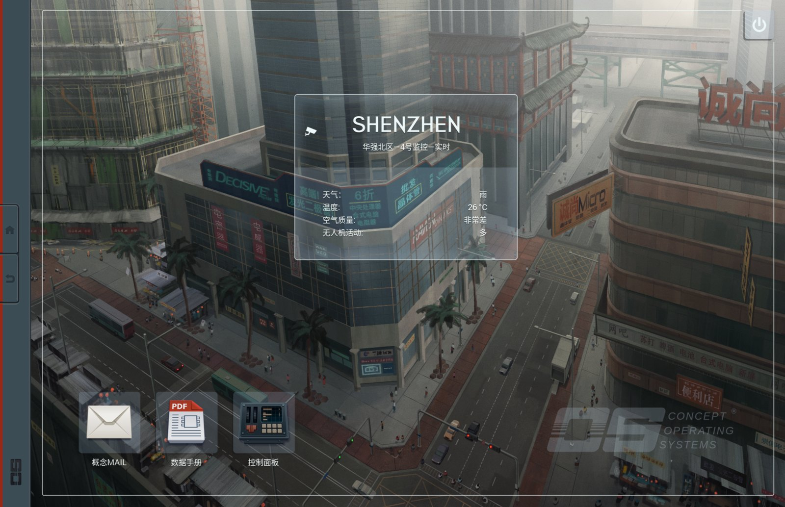

# SHENZHEN I/O GUI Scale

一个给 macOS 版 **SHENZHEN I/O** 使用的 GUI 缩放工具。

它不是 DLL 注入，也不是系统级放大镜。SHENZHEN I/O 没有公开的代码 mod loader，所以这里使用游戏自己的 `config.cfg`：

- 开启全屏
- 降低游戏的内部渲染分辨率
- 让全屏输出继续保持显示器分辨率
- 结果就是菜单、文字和整个游戏界面一起变大

## 文件

```text
shenzhen-scale           # 编译好的命令行工具
shenzhen-scale.command   # 双击打开的选择菜单
shenzhen-scale.swift     # 源码
```

## 使用

先退出 SHENZHEN I/O。

### 方式一：双击

双击 `shenzhen-scale.command`，选择：

```text
1   原版 1x
2   1.5x
3   2x
4   2.5x
5   3x
s   查看当前状态
r   恢复原配置
```

选择后会自动写入配置并请求 Steam 启动游戏。

### 方式二：终端

```bash
cd /path/to/SHENZHEN-IO-GUI-Scale

./shenzhen-scale.command 2
```

其他命令：

```bash
./shenzhen-scale.command 1.5
./shenzhen-scale.command 2.5
./shenzhen-scale.command status
./shenzhen-scale.command restore
```

## 备份与恢复

第一次调整时，会自动备份原始配置：

```text
config.cfg.gui-scale-backup
```

执行：

```bash
./shenzhen-scale.command restore
```

即可恢复原始配置。

## 原理与效果

例如你的主显示器内部像素尺寸是 `3456 × 2234`：

- `1x`：内部渲染 `3456 × 2234`
- `2x`：内部渲染 `1728 × 1117`
- `3x`：内部渲染 `1152 × 745`

全屏输出仍然是显示器原生像素，但游戏内部画布降低了，所以：

- UI 会变大
- 3D/背景画面会稍微变软
- 不需要系统级放大器
- 不需要修改游戏 exe

## 注意

- 当前工具面向 macOS Steam 版 SHENZHEN I/O，Steam App ID 为 `504210`。
- 使用前最好先退出游戏，否则 Steam 可能只是把已经运行的游戏切到前台。
- 工具默认按主显示器像素尺寸计算缩放。如果游戏在副屏启动，缩放比例可能不准确。
- 如果游戏更新覆盖了配置，重新运行一次工具即可。


